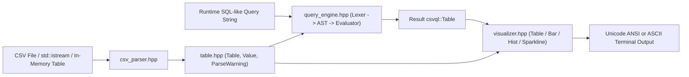

# csvql

[](https://en.cppreference.com/w/cpp/17)
[](include/csvql/csvql.hpp)
[](#quick-start)
[](LICENSE)

**A zero-dependency, header-only C++17 library combining fault-tolerant RFC-4180 CSV parsing, a runtime SQL-like query & aggregation engine, and native Unicode/ASCII terminal charting.**

> Drop `#include <csvql/csvql.hpp>` into any C++17 codebase — load messy CSVs (or construct in-memory `csvql::Table` objects), run dynamic `SELECT ... WHERE ... GROUP BY ... HAVING ... ORDER BY ... LIMIT` queries without recompiling, and render aligned tables, diverging `+/-` bar charts, histograms, and sparklines directly in the terminal.

---

## Motivation

In C++ coursework, quantitative analysis prototypes, and backend CLI tools, developers frequently need to inspect and summarize tabular `.csv` datasets directly from C++. However, existing choices leave an awkward gap:

1. **Recompile-per-question friction:** Lightweight C++ CSV parsers (such as `rapidcsv` or `fast-cpp-csv-parser`) only expose raw row/column accessors. Changing a filter condition, adding a `GROUP BY` summary, or adjusting sort order forces you to write new C++ loops and recompile.
2. **Dirty-data fragility:** Real-world CSV exports often contain `"N/A"`, `"NaN"`, `"--"`, UTF-8 BOM headers, quoted commas, or ragged rows — causing strict parsers to throw exceptions and abort mid-pipeline.
3. **Heavyweight dependencies for simple visual inspection:** Embedding `SQLite` or `DuckDB` pulls in hundreds of thousands of lines of C/C++ and requires pre-creating schemas, while plotting with `matplotlib-cpp` couples a native C++ binary to an external Python/NumPy installation.

`csvql` bridges this gap in 2,491 lines across five clean, readable C++17 headers with **zero third-party dependencies**.

---

## Innovation & Comparison with Existing Packages

Why cannot existing packages easily replace `csvql` as a single drop-in component?

| Capability | `rapidcsv` / `fast-cpp-csv-parser` | `SQLite` / `DuckDB` | `matplotlib-cpp` | `tabulate` + `asciichart` | **`csvql` (Ours)** |
| :--- | :---: | :---: | :---: | :---: | :---: |
| **Header-only, zero dependencies** | Yes | No (large build / C-ABI) | No (requires Python + NumPy) | Yes (2 separate libs) | **Yes (single umbrella header)** |
| **Fault-tolerant `"N/A"` & ragged rows** | Throws / manual handling | Strict import schemas | N/A | N/A | **Auto-coerces to `NULL` + `ParseWarning` log** |
| **Runtime SQL-like `WHERE` / `GROUP BY` / `HAVING`** | No (hardcoded C++ loops) | Yes (requires table import) | No | No | **Yes (in-memory Lexer + AST + Evaluator)** |
| **Native terminal tables + diverging `+/-` bar charts** | No | No | GUI window (no terminal UI) | Separate APIs; no diverging axis | **Yes (Unicode + strict ASCII fallback)** |
| **Safe C++ type guards (`"0x10"`, `"inf"`, `"10A"`)** | Varies | Schema-bound | N/A | N/A | **Strict finite `double` vs `string` separation** |

> **Summary for Package Reuse:** Existing packages such as `rapidcsv`, `SQLite`, and `tabulate` either lack runtime `GROUP BY` / `HAVING` querying over dirty CSVs (`rapidcsv`), require heavy external build/runtime stacks (`SQLite`, `matplotlib-cpp`), or only print pre-computed arrays without querying (`tabulate`, `asciichart`). `csvql` resolves all three together in a self-contained header-only C++17 library with a built-in interactive REPL for ad-hoc exploration.

---

## Architecture



- `include/csvql/table.hpp` — Dynamic `Value` (`std::variant<std::monostate, double, std::string>`), `ParseWarning`, and case-insensitive `Table`.
- `include/csvql/csv_parser.hpp` — RFC-4180 parser (UTF-8 BOM stripping, quoted multiline fields, `""` unescaping, strict numeric detection, `N/A` -> `NULL` coercion, ragged row padding/truncation).
- `include/csvql/query_engine.hpp` — Three-stage SQL-like engine (`SELECT`, optional `FROM`, `WHERE`, `GROUP BY`, `HAVING`, `ORDER BY`, `LIMIT`, `COUNT/SUM/AVG/MIN/MAX`, `AND/OR/NOT`, `CONTAINS`, `IS [NOT] NULL`).
- `include/csvql/visualizer.hpp` — UTF-8 display-width-aware table box renderer, diverging `+/-` zero-axis horizontal bar chart, equal-width histogram, single-line sparkline, and Windows UTF-8/VT console helper (`enable_console_utf8()`).
- `include/csvql/csvql.hpp` — Single umbrella header plus convenience helper `csvql::query_csv(path, sql)`.

---

## Quick Start

### Option 1: Copy Header Directory (Zero Build Tools Needed)

Copy `include/csvql/` into your project and compile any C++17 file directly:

```bash
g++ -std=c++17 -O2 -Iinclude examples/basic_usage.cpp -o basic_usage
./basic_usage
```

### Option 2: Build Everything Locally (Windows PowerShell or Make)

```powershell
# Windows PowerShell (uses g++ with -Wall -Wextra -Wpedantic -Werror)
.\build.ps1
```

```bash
# Linux / macOS / MSYS2 Make
make test
make demo
```

### Option 3: CMake (`add_subdirectory` or `FetchContent`)

```cmake
include(FetchContent)
FetchContent_Declare(
  csvql
  GIT_REPOSITORY https://github.com/<member-a-github>/csvql.git
  GIT_TAG        main
)
FetchContent_MakeAvailable(csvql)

target_link_libraries(your_target PRIVATE csvql::csvql)
```

Or build the repository with CMake directly:

```bash
cmake -B build -DCMAKE_BUILD_TYPE=Release
cmake --build build --config Release
ctest --test-dir build --output-on-failure -C Release
```

### CLI Tool & Interactive REPL Modes

`examples/demo_cli.cpp` builds into `csvql_demo`:

```bash
# 1. Run the 1-minute self-contained lecture demo
./build/csvql_demo --demo

# 2. Pure 7-bit ASCII fallback (for legacy terminals / fonts)
./build/csvql_demo --demo --ascii --no-color

# 3. Interactive SQL + Charting REPL (great for live Q&A!)
./build/csvql_demo --repl data/stocks.csv

# 4. One-shot CLI query + chart
./build/csvql_demo data/stocks.csv "SELECT sector, AVG(daily_return_pct) AS avg_ret GROUP BY sector ORDER BY avg_ret DESC" --bar sector avg_ret
```

---

## Example Use Cases

### 1. Minimal C++17 Library Integration (`examples/basic_usage.cpp`)

```cpp
#include <csvql/csvql.hpp>
#include <iostream>

int main() {
    csvql::enable_console_utf8();

    csvql::Table stocks = csvql::load_csv("data/stocks.csv");
    csvql::Table summary = csvql::query(
        stocks,
        "SELECT sector, COUNT(*) AS tickers, AVG(daily_return_pct) AS avg_ret, MAX(adr_pct) AS max_adr "
        "GROUP BY sector HAVING COUNT(*) >= 3 ORDER BY avg_ret DESC");

    csvql::RenderOptions opts;
    opts.title = "Sector Summary (via csvql)";
    csvql::render_table(summary, std::cout, opts);

    std::cout << "\n";
    opts.title = "Average Daily Return (%) by Sector";
    csvql::render_bar_chart(summary, "sector", "avg_ret", std::cout, opts);
}
```

### 2. Real Output from `csvql_demo --demo`

```text
[Part A] Fault-Tolerant CSV Load + Runtime SQL-like Query (stocks.csv)
────────────────────────────────────────────────────────────────────
Loaded 30 rows x 6 cols (2 dirty 'N/A' cells safely coerced to NULL without throwing)
  Sample warning -> line 11, col 4: Dirty sentinel 'N/A' in column 'volume_m' coerced to NULL
SQL> SELECT sector, COUNT(*) AS tickers, COUNT(adr_pct) AS valid_adr,
            AVG(daily_return_pct) AS avg_ret, MAX(adr_pct) AS max_adr
     GROUP BY sector HAVING COUNT(*) >= 3 ORDER BY avg_ret DESC

┌────────────┬─────────┬───────────┬─────────┬─────────┐
│ sector     │ tickers │ valid_adr │ avg_ret │ max_adr │
├────────────┼─────────┼───────────┼─────────┼─────────┤
│ Tech       │       6 │         6 │    2.36 │    5.10 │
│ Healthcare │       6 │         6 │    1.03 │    2.60 │
│ Finance    │       6 │         6 │    0.37 │    2.30 │
│ Consumer   │       6 │         6 │   -0.54 │    5.85 │
│ Energy     │       6 │         5 │   -1.77 │    3.10 │
└────────────┴─────────┴───────────┴─────────┴─────────┘
(5 rows)

[Part B] Diverging Bar Chart, Return Histogram & Cross-Domain Reuse
────────────────────────────────────────────────────────────────────
1) Average Daily Return (%) by Sector
Tech                        │████████████████  +2.36
Healthcare                  │███████           +1.03
Finance                     │██                +0.37
Consumer                ████│                  -0.54
Energy          ████████████│                  -1.77

2) Daily Return Distribution across All Stocks (%)
[-2.65, -1.43) │ ▇▇▇▇▇▇▇▇▇▇▇▇▇▇▇▇▇▇▇▇▇▇▇▇          6 (20.0%)
[-1.43, -0.21) │ ▇▇▇▇▇▇▇▇▇▇▇▇▇▇▇▇▇▇▇▇▇▇▇▇          6 (20.0%)
[-0.21, 1.01)  │ ▇▇▇▇▇▇▇▇▇▇▇▇▇▇▇▇▇▇▇▇▇▇▇▇▇▇▇▇      7 (23.3%)
[1.01, 2.23)   │ ▇▇▇▇▇▇▇▇▇▇▇▇▇▇▇▇▇▇▇▇▇▇▇▇▇▇▇▇▇▇▇▇  8 (26.7%)
[2.23, 3.45]   │ ▇▇▇▇▇▇▇▇▇▇▇▇                      3 (10.0%)

3) Daily Return Sparkline
█▇▆▅▇▆▆▅▆▅▅▅▅▅▄▄▅▄▆▁▂▃▄▅▂▂▁▂▂▃  (n=30, min=-2.65, avg=0.29, max=3.45)

Cross-domain check (data/sales.csv):
SQL> SELECT category, SUM(units) AS units, SUM(revenue) AS total_rev,
            AVG(margin_pct) AS avg_margin GROUP BY category ORDER BY total_rev DESC

4) E-Commerce Total Revenue by Category ($)
Cloud    │ ████████████████████████████████  141600
Hardware │ ████████████████                   70150
Services │ ███████████████                    65800

Completed full load + 2 SQL aggregations + 4 terminal visuals in 0.90 ms.
```

### 3. In-Memory `csvql::Table` (No CSV File Required)

```cpp
csvql::Table metrics({"service", "latency_ms", "delta_ms"});
metrics.add_row({"auth", 12.4, -2.1});
metrics.add_row({"search", 45.8, 6.5});
metrics.add_row({"checkout", 28.0, -4.3});
metrics.add_row({"billing", 19.2, 1.8});

csvql::Table ranked = csvql::query(metrics, "SELECT service, latency_ms, delta_ms ORDER BY delta_ms DESC");
csvql::render_bar_chart(ranked, "service", "delta_ms", std::cout);
```

---

## Documentation

- [API & SQL Reference (`docs/API.md`)](docs/API.md)

---

## Division of Work & Team Members

| Member | GitHub Account | Owned Modules & Deliverables |
| :--- | :--- | :--- |
| **Member A** | `<daviddd09100910-lab>` | `include/csvql/table.hpp`, `include/csvql/csv_parser.hpp`, `include/csvql/query_engine.hpp`, `tests/test_parser_and_query.cpp`, `docs/API.md` (SQL Engine sections) |
| **Member B** | `<Kwunmlai-lab>` | `include/csvql/visualizer.hpp`, `include/csvql/csvql.hpp`, `data/stocks.csv`, `data/sales.csv`, `examples/basic_usage.cpp`, `examples/demo_cli.cpp`, `tests/test_visualizer.cpp`, `CMakeLists.txt`, `.github/workflows/ci.yml`, `README.md` |

---

## License

Released under the [MIT License](LICENSE).
